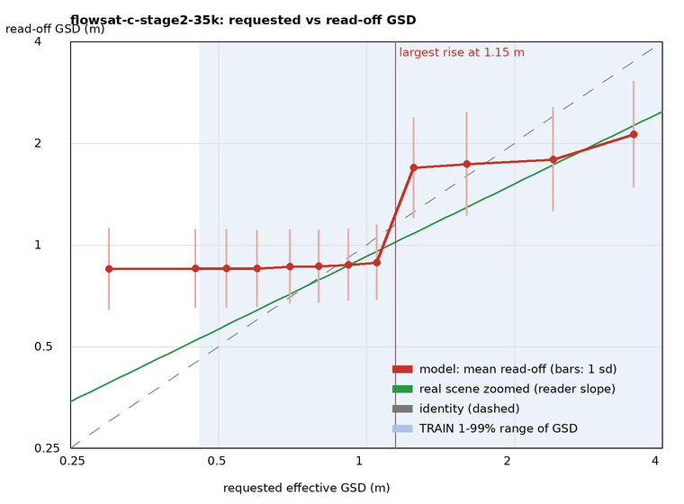

# MetaCF v2.3 card: flowsat-c-stage2-35k

config `8cc77d455147` · protocol `3d93743c1f43` · checkpoint `flowsat_c_35k.safetensors` · guidance {'w_txt': 2.0, 'w_md': 2.0, 'steps': 20} · B=1000 · BH q=0.05

Every test is reported on its own; there is no combined score. IN RANGE is primary for every field: values stay inside the anchor category's TRAIN [1, 99] % support of the field (GSD: of effective GSD). For GSD each test also has a labelled full-range (EXTRAPOLATION) value. Scores are bounded to [0, 1]: below 0 -> 0, above 1 -> 1, and for ratio metrics min(k, 1 / k), so an overshoot by a factor k costs as much as an undershoot by k; the unbounded value is shown when it differs, and CIs are those of the unbounded value. A cell is INVALID when its real-data reference (ceiling minus floor) is not significantly above zero. E4 (year ordering) is dropped (dataset-dependent).

## Per field
| field | group | C0 ratio | C1 | C1 magnitude: 1-|log2 k| (used) / min(k,1/k) | C2 tau | C3 floored (primary) | C3 unfloored | C4 |
|---|---|---|---|---|---|---|---|---|
| latlon | geo | 1.18 (active) |  |  |  | 0.94 (unbounded 1.06) | 0.87 (unbounded 1.15) |  |
| gsd | gsd | in-range 0.14 (not active) · full-range 0.91 | in-range 0.13 · full-range up 0.76 (unbounded 1.32) / down 0.06 | 0.00 / 0.07 | in-range 0.13 · full-range 0.95 | 0.91 | 0.84 | 0.70 |
| doy | doy | 0.33 (active) | 0.72 | 0.61 / 0.76 | 0.44 | 0.69 | 0.90 (unbounded 1.12) | 0.49 |
| sun_elev | solar | 0.63 (active) | 0.78 | 0.51 / 0.71 | 0.65 | 0.99 | 0.90 (unbounded 1.11) | 0.78 |
| cloud | cloud | 0.39 (active) | 0.84 | 0.65 / 0.78 | INVALID | 0.67 (unbounded 1.48) | 0.79 (unbounded 1.27) | 0.92 |
| year | year | 0.19 (active) | 0.56 | 0.00 / 0.40 | INVALID | INVALID | INVALID | 0.26 |
| sensor | sensor | 0.33 (active) | 0.65 | 0.46 / 0.69 | 0.59 | 0.86 | 0.70 | 0.08 |
| elevation | cov | 0.53 (active) |  |  |  | 0.54 (unbounded 1.85) | 0.77 (unbounded 1.30) |  |
| relief | cov | 0.53 (active) |  |  |  | 0.67 (unbounded 1.50) | 0.87 (unbounded 1.15) |  |
| coast | cov | 0.53 (active) |  |  |  | 0.66 (unbounded 1.50) | 0.77 (unbounded 1.30) |  |
| population | cov | 0.53 (active) |  |  |  | 0.72 (unbounded 1.40) | 0.94 (unbounded 1.06) |  |
| koppen | cov | 0.53 (active) |  |  |  | INVALID | 0.78 (unbounded 1.28) |  |
| landcover | cov | 0.53 (active) |  |  |  | 0.70 (unbounded 1.43) | 0.77 (unbounded 1.29) |  |

C0 = image change when only this field's group changes / seed-to-seed change (a ratio, not a 0-1 score). C1 = counterfactual fidelity; for gsd it is a zoom score: the change read off by the real-trained GSD reader / the change it reads on a real zoom of the same size. C2 = a reader trained on generated images, tested on reals; for gsd it must order real zoom ladders of one scene. C3 floored = (gain_gen - gain_floor) / (gain_real - gain_floor), floor = the same model with the field's group taken from another record (500-record subset). C3 unfloored = gain_gen / gain_real; a value above 1 means the generated images express the field more cleanly than real images do, not that control is better. C4 = distribution match within bins of the field.

## GSD panel (GSD is scored as zoom, with a GSD reader trained on real images only)

PRIMARY = in range (inside the anchor category's TRAIN [1, 99] % support of effective GSD), comparable with the other fields. EXTRAPOLATION = the wide 0.3-3.5 m sweep and the x2 / /2 requests, mostly outside that support; the same protocol for every model.

|  | test | value [95% CI] | bounded score | range covered |
|---|---|---|---|---|
| PRIMARY | C0 ratio (effect / seed noise) | 0.14 [0.10, 0.19] |  | TRAIN p5 0.534 vs p95 0.979 |
| PRIMARY | C1 zoom, in range: read-off change / real zoom change | 0.13 [0.05, 0.22] | 0.13 | IN RANGE: same-site TEST pairs, requested gsd change x1.01 to x1.40 (median x1.07), both ends real values of the site |
| PRIMARY | C1 zoom, in range: fraction of pairs moving the right way | 0.58 [0.53, 0.63] | 0.58 | as above (0.5 = chance) |
| PRIMARY | C2 within-scene: syn reader orders real zoom ladders (Spearman) | 0.66 (floor 0.64, real 0.83) | 0.13 | C2 generations: 1000 images, requested 0.38-9.73 m (inside each category's TRAIN support) |
| PRIMARY | C2 within-scene slope | 0.45 (floor 0.00, real 0.71) | 0.63 | C2 generations: 1000 images, requested 0.38-9.73 m (inside each category's TRAIN support) |
| PRIMARY | E1 match Spearman, in range | 0.19 [0.02, 0.35] | 0.19 | sweep levels inside the category support; median 5.0 levels, 96 sweeps |
| PRIMARY | E1 match slope / real slope, in range | 0.06 [-0.02, 0.13] | 0.06 | sweep levels inside the category support; median 5.0 levels, 96 sweeps |
| EXTRAPOLATION | C0 ratio | 0.91 [0.68, 1.14] |  | EXTRAPOLATION: anchor's own gsd vs own x 2 |
| EXTRAPOLATION | C1 zoom OUT (x2): read-off change / real x2 zoom | 1.32 [1.19, 1.51] | 0.76 (unbounded 1.32) | EXTRAPOLATION: own gsd -> x2 (requested 1.08-1.98 m, 1% of targets inside the category TRAIN support) |
| EXTRAPOLATION | C1 zoom IN (/2): read-off change / real x2 zoom | 0.06 [0.02, 0.11] | 0.06 | EXTRAPOLATION: own gsd -> /2 (requested 0.27-0.50 m, 18% of targets inside the category TRAIN support) |
| EXTRAPOLATION | C1 zoom OUT: fraction of pairs zooming out | 0.96 [0.94, 0.99] | 0.96 | as zoom OUT |
| EXTRAPOLATION | C1 zoom IN: fraction of pairs zooming in | 0.56 [0.49, 0.63] | 0.56 | as zoom IN |
| EXTRAPOLATION | C2 within-scene Spearman, syn reader trained on the full sweep | 0.78 (floor -0.10, real 0.83) | 0.95 | E1 dense sweep: 100 sweeps x 12 levels 0.3-3.5 m |
| EXTRAPOLATION | C2 within-scene slope, full sweep | 0.64 (floor 0.00, real 0.71) | 0.90 | E1 dense sweep: 100 sweeps x 12 levels 0.3-3.5 m |
| EXTRAPOLATION | E1 match Spearman, full sweep | 0.75 [0.71, 0.79] | 0.75 | 12 levels 0.3-3.5 m, 2 seeds |
| EXTRAPOLATION | E1 match slope / real slope, full sweep | 0.65 [0.61, 0.69] | 0.65 | 12 levels 0.3-3.5 m, 2 seeds |
| EXTRAPOLATION | E1 match: sweeps strictly monotone | 0.01 [0.00, 0.04] | 0.01 | 12 levels 0.3-3.5 m, 2 seeds |
| EXTRAPOLATION | E1 match: seed agreement | 0.77 [0.72, 0.81] | 0.77 | 12 levels 0.3-3.5 m, 2 seeds |
| EXTRAPOLATION | requested GSD at the largest rise of the mean curve (m) | 1.15 [1.15, 1.15] |  | 12 levels 0.3-3.5 m, 2 seeds |
| EXTRAPOLATION | largest rise / total rise (1 = one step) | 0.70 [0.66, 0.75] |  | an even ramp would give 0.09 |
| secondary | C1 feature-direction score (v2.1 zoom reference) | 0.34 [0.28, 0.37] | 0.34 | same-site TEST pairs, in range |
| secondary | C2 tau, cross-scene R^2 (v2) | 0.52 (floor 0.49, real 0.90) | 0.05 | 5 values inside the category support; 2000 real TEST tiles |
| secondary | E1 match Spearman, in range (v2 E1 cells) | 0.26 [0.08, 0.44] | 0.26 | 5 levels inside the category support, 1 seed |
| secondary | E1 match slope, in range (v2 E1 cells) | 0.09 [0.02, 0.16] | 0.09 | 5 levels inside the category support, 1 seed |

Zoom-out / zoom-in asymmetry: a x2 request moves the read-off by 1.32 of a real x2 zoom (96% of pairs zoom out); a /2 request by 0.06 (56% of pairs zoom in).

Mean read-off per requested level (fixed caption, seed, other metadata):

| requested (m) | 0.3 | 0.45 | 0.52 | 0.6 | 0.7 | 0.8 | 0.92 | 1.05 | 1.25 | 1.6 | 2.4 | 3.5 |
|---|---|---|---|---|---|---|---|---|---|---|---|---|
| read-off (m) | 0.85 | 0.85 | 0.85 | 0.85 | 0.86 | 0.86 | 0.87 | 0.89 | 1.69 | 1.74 | 1.79 | 2.12 |
| sd of log read-off | 0.28 | 0.27 | 0.27 | 0.26 | 0.25 | 0.25 | 0.24 | 0.26 | 0.34 | 0.35 | 0.35 | 0.36 |

`gsd_curve.png`: identical axes for every model; green = what the reader reports when a REAL scene is zoomed (slope c_within, anchored at the TRAIN median); dashed = identity.

## C0 coverage
| field | metric | raw | floor | ceil | score | unbounded | CI | p_BH | N | space | status | notes |
|---|---|---|---|---|---|---|---|---|---|---|---|---|
| geo | ratio | 1.179 |  |  |  |  | [0.958, 1.520] | 0.0000 | 20 | dino | OK MODIFIED | active=True |
| gsd | ratio | 0.142 |  |  |  |  | [0.099, 0.192] | 0.1130 | 20 | clip | OK MODIFIED | active=False |
| doy | ratio | 0.331 |  |  |  |  | [0.217, 0.449] | 0.0012 | 20 | dino | OK MODIFIED | active=True |
| solar | ratio | 0.627 |  |  |  |  | [0.504, 0.784] | 0.0000 | 20 | dino | OK MODIFIED | active=True |
| cloud | ratio | 0.391 |  |  |  |  | [0.280, 0.521] | 0.0001 | 20 | stats | OK MODIFIED | active=True |
| year | ratio | 0.194 |  |  |  |  | [0.142, 0.256] | 0.0012 | 20 | stats | OK MODIFIED | active=True |
| sensor | ratio | 0.328 |  |  |  |  | [0.225, 0.447] | 0.0010 | 20 | clip | OK MODIFIED | active=True |
| cov | ratio | 0.527 |  |  |  |  | [0.421, 0.623] | 0.0000 | 20 | dino | OK MODIFIED | active=True |
| gsd | ratio_extrap | 0.915 |  |  |  |  | [0.683, 1.141] | 0.0000 | 20 | clip | OK MODIFIED |  |
| * | coverage | 0.875 |  |  | 0.875 | 0.875 | [, ] |  | 8 |  | OK | active=['geo', 'doy', 'solar', 'cloud', 'year', 'sensor', 'cov'] |

## C1 counterfactual fidelity
| field | metric | raw | floor | ceil | score | unbounded | CI | p_BH | N | space | status | notes |
|---|---|---|---|---|---|---|---|---|---|---|---|---|
| gsd | zoom_in_range | 0.127 |  |  | 0.127 | 0.127 | [0.052, 0.219] |  | 400 | dino | OK |  |
| gsd | zoom_sign_in_range | 0.583 |  |  | 0.583 | 0.583 | [0.534, 0.631] |  | 400 | dino | OK |  |
| gsd | zoom_up | 1.324 |  |  | 0.755 | 1.324 | [1.192, 1.505] | 0.0012 | 200 | dino | OK |  |
| gsd | zoom_down | 0.062 |  |  | 0.062 | 0.062 | [0.024, 0.107] | 0.0012 | 200 | dino | OK |  |
| gsd | zoom_sign_up | 0.965 |  |  | 0.965 | 0.965 | [0.936, 0.985] |  | 200 | dino | OK |  |
| gsd | zoom_sign_down | 0.565 |  |  | 0.565 | 0.565 | [0.495, 0.630] |  | 200 | dino | OK |  |
| gsd | direction | 0.201 | 0.000 | 0.924 | 0.218 | 0.218 | [0.057, 0.295] |  | 400 | clip | OK |  |
| gsd | magnitude | 0.071 |  |  | 0.000 | 0.000 | [0.019, 0.123] |  | 400 | clip | OK |  |
| gsd | specificity | 0.792 |  |  | 0.792 | 0.792 | [0.756, 0.827] |  | 400 | clip | OK |  |
| gsd | agreement | 0.047 |  |  |  |  | [-0.056, 0.145] |  | 400 | clip | OK |  |
| gsd | score | 0.336 |  |  | 0.336 | 0.336 | [0.276, 0.369] | 0.0012 | 400 | clip | OK | kappa=0.071 |
| sensor | direction | 0.638 | 0.000 | 0.972 | 0.656 | 0.656 | [0.563, 0.651] |  | 400 | clip | OK |  |
| sensor | magnitude | 0.689 |  |  | 0.462 | 0.462 | [0.601, 0.752] |  | 400 | clip | OK |  |
| sensor | specificity | 0.834 |  |  | 0.834 | 0.834 | [0.789, 0.863] |  | 400 | clip | OK |  |
| sensor | agreement | 0.294 |  |  |  |  | [0.180, 0.399] |  | 400 | clip | OK |  |
| sensor | score | 0.651 |  |  | 0.651 | 0.651 | [0.551, 0.691] | 0.0012 | 400 | clip | OK | kappa=0.689 |
| doy | direction | 0.699 | 0.000 | 0.961 | 0.727 | 0.727 | [0.545, 0.697] |  | 400 | dino | OK |  |
| doy | magnitude | 0.765 |  |  | 0.613 | 0.613 | [0.600, 0.903] |  | 400 | dino | OK |  |
| doy | specificity | 0.809 |  |  | 0.809 | 0.809 | [0.716, 0.867] |  | 400 | dino | OK |  |
| doy | agreement | 0.527 |  |  |  |  | [0.436, 0.609] |  | 400 | dino | OK |  |
| doy | score | 0.716 |  |  | 0.716 | 0.716 | [0.535, 0.777] | 0.0012 | 400 | dino | OK | kappa=0.765 |
| sun_elev | direction | 0.916 | 0.000 | 0.991 | 0.925 | 0.925 | [0.870, 0.924] |  | 400 | dino | OK |  |
| sun_elev | magnitude | 0.712 |  |  | 0.511 | 0.511 | [0.654, 0.766] |  | 400 | dino | OK |  |
| sun_elev | specificity | 0.908 |  |  | 0.908 | 0.908 | [0.875, 0.928] |  | 400 | dino | OK |  |
| sun_elev | agreement | 0.673 |  |  |  |  | [0.607, 0.730] |  | 400 | dino | OK |  |
| sun_elev | score | 0.781 |  |  | 0.781 | 0.781 | [0.715, 0.815] | 0.0012 | 400 | dino | OK | kappa=0.712 |
| cloud | direction | 0.983 | 0.000 | 0.990 | 0.993 | 0.993 | [0.944, 0.998] |  | 400 | stats | OK |  |
| cloud | magnitude | 1.279 |  |  | 0.645 | 0.645 | [0.886, 1.720] |  | 400 | stats | OK |  |
| cloud | specificity | 0.874 |  |  | 0.874 | 0.874 | [0.622, 0.963] |  | 400 | stats | OK |  |
| cloud | agreement | 0.639 |  |  |  |  | [0.571, 0.698] |  | 400 | stats | OK |  |
| cloud | score | 0.837 |  |  | 0.837 | 0.837 | [0.607, 0.966] | 0.0012 | 400 | stats | OK | kappa=1.279 |
| year | direction | 0.773 | 0.000 | 0.841 | 0.919 | 0.919 | [0.471, 1.000] |  | 400 | stats | OK |  |
| year | magnitude | 0.402 |  |  | 0.000 | 0.000 | [0.184, 0.558] |  | 400 | stats | OK |  |
| year | specificity | 0.749 |  |  | 0.749 | 0.749 | [0.576, 0.868] |  | 400 | stats | OK |  |
| year | agreement | 0.138 |  |  |  |  | [0.026, 0.247] |  | 400 | stats | OK |  |
| year | score | 0.556 |  |  | 0.556 | 0.556 | [0.379, 0.635] | 0.0012 | 400 | stats | OK | kappa=0.402 |

## C2 transfer
| field | metric | raw | floor | ceil | score | unbounded | CI | p_BH | N | space | status | notes |
|---|---|---|---|---|---|---|---|---|---|---|---|---|
| gsd | tau | 0.516 | 0.495 | 0.898 | 0.053 | 0.053 | [0.039, 0.067] | 0.0012 | 2000 | clip | OK | s_real_lo=0.876; min_real=0.050; s_real_within_cat=0.358; s_syn_within_cat=-2.044 |
| gsd | tau_within_scene | 0.662 | 0.636 | 0.832 | 0.133 | 0.133 | [0.051, 0.215] | 0.0012 | 538 | dino | OK |  |
| gsd | slope_within_scene | 0.452 | 0.000 | 0.714 | 0.633 | 0.633 | [0.591, 0.673] | 0.0012 | 538 | dino | OK |  |
| gsd | tau_within_scene_full | 0.783 | -0.105 | 0.832 | 0.948 | 0.948 | [0.906, 0.990] | 0.0012 | 538 | dino | OK |  |
| gsd | slope_within_scene_full | 0.645 | 0.000 | 0.714 | 0.904 | 0.904 | [0.845, 0.969] | 0.0012 | 538 | dino | OK |  |
| doy | tau | 0.094 | -0.029 | 0.253 | 0.436 | 0.436 | [0.305, 0.579] | 0.0012 | 2000 | dino | OK | s_real_lo=0.202; min_real=0.050 |
| sun_elev | tau | 0.158 | -0.654 | 0.599 | 0.648 | 0.648 | [0.612, 0.680] | 0.0012 | 2000 | dino | OK | s_real_lo=0.566; min_real=0.050; s_real_within_cat=0.600; s_syn_within_cat=0.159 |
| cloud | tau | -2.797 | -2.942 | 0.013 |  |  | [0.045, 0.053] | 0.0012 | 2000 | stats | INVALID | s_real_lo=0.001; min_real=0.050; s_real_within_cat=0.015; s_syn_within_cat=-2.788 |
| year | tau | -2.453 | -2.458 | -0.036 |  |  | [0.002, 0.002] | 0.0012 | 2000 | stats | INVALID | s_real_lo=-0.075; min_real=0.050; s_real_within_cat=-0.034; s_syn_within_cat=-2.445 |
| sensor | tau | 0.526 | 0.266 | 0.705 | 0.592 | 0.592 | [0.523, 0.664] | 0.0012 | 2000 | clip | OK | s_real_lo=0.674; min_real=0.300 |

## C3 conditional information
| field | metric | raw | floor | ceil | score | unbounded | CI | p_BH | N | space | status | notes |
|---|---|---|---|---|---|---|---|---|---|---|---|---|
| latlon | ratio_floored | 1937.362 | -51.574 | 1818.363 | 0.940 | 1.064 | [0.851, 1.314] | 0.0012 | 500 | dino | OK | gain_real=1818.363; gain_gen=1937.362 |
| latlon | ratio | 1796.813 | 0.000 | 1560.308 | 0.868 | 1.152 | [1.001, 1.284] | 0.0012 | 2000 | dino | OK | gain_real=1560.308; gain_gen=1796.813 |
| gsd | ratio_floored | 0.422 | -0.477 | 0.507 | 0.914 | 0.914 | [0.867, 0.948] | 0.0012 | 500 | clip+dino | OK | gain_real=0.507; gain_gen=0.422 |
| gsd | ratio | 0.452 | 0.000 | 0.538 | 0.841 | 0.841 | [0.787, 0.882] | 0.0012 | 2000 | clip+dino | OK | gain_real=0.538; gain_gen=0.452 |
| doy | ratio_floored | 0.161 | 0.111 | 0.184 | 0.686 | 0.686 | [-0.829, 3.417] | 0.0323 | 500 | dino | OK | gain_real=0.184; gain_gen=0.161 |
| doy | ratio | 0.206 | 0.000 | 0.184 | 0.897 | 1.115 | [0.941, 1.330] | 0.0012 | 2000 | dino | OK | gain_real=0.184; gain_gen=0.206 |
| sun_elev | ratio_floored | 0.471 | 0.071 | 0.474 | 0.993 | 0.993 | [0.875, 1.149] | 0.0012 | 500 | dino | OK | gain_real=0.474; gain_gen=0.471 |
| sun_elev | ratio | 0.508 | 0.000 | 0.459 | 0.904 | 1.107 | [1.042, 1.176] | 0.0012 | 2000 | dino | OK | gain_real=0.459; gain_gen=0.508 |
| cloud | ratio_floored | 0.014 | -0.017 | 0.004 | 0.675 | 1.482 | [0.788, 4.709] | 0.0124 | 500 | stats+dino | OK | gain_real=0.004; gain_gen=0.014 |
| cloud | ratio | 0.021 | 0.000 | 0.017 | 0.790 | 1.266 | [0.790, 2.196] | 0.0012 | 2000 | stats+dino | OK | gain_real=0.017; gain_gen=0.021 |
| year | ratio_floored | -0.054 | -0.069 | -0.038 |  |  | [-3.753, 3.125] | 0.1411 | 500 | stats+dino | INVALID | gain_real=-0.038; gain_gen=-0.054 |
| year | ratio | -0.048 | 0.000 | -0.044 |  |  | [0.604, 1.936] | 1.0000 | 2000 | stats+dino | INVALID | gain_real=-0.044; gain_gen=-0.048 |
| sensor | ratio_floored | 0.220 | -0.127 | 0.278 | 0.857 | 0.857 | [0.691, 1.063] | 0.0012 | 500 | clip+dino | OK | gain_real=0.278; gain_gen=0.220 |
| sensor | ratio | 0.156 | 0.000 | 0.222 | 0.703 | 0.703 | [0.580, 0.836] | 0.0012 | 2000 | clip+dino | OK | gain_real=0.222; gain_gen=0.156 |
| elevation | ratio_floored | 0.136 | 0.038 | 0.091 | 0.542 | 1.846 | [0.633, 7.268] | 0.0223 | 500 | dino | OK | gain_real=0.091; gain_gen=0.136 |
| elevation | ratio | 0.147 | 0.000 | 0.113 | 0.771 | 1.297 | [1.037, 1.603] | 0.0012 | 2000 | dino | OK | gain_real=0.113; gain_gen=0.147 |
| relief | ratio_floored | 0.161 | 0.018 | 0.113 | 0.667 | 1.499 | [0.939, 3.860] | 0.0035 | 500 | dino | OK | gain_real=0.113; gain_gen=0.161 |
| relief | ratio | 0.155 | 0.000 | 0.134 | 0.869 | 1.150 | [0.946, 1.449] | 0.0012 | 2000 | dino | OK | gain_real=0.134; gain_gen=0.155 |
| coast | ratio_floored | 0.127 | 0.047 | 0.100 | 0.665 | 1.504 | [-1.366, 6.833] | 0.0307 | 500 | dino | OK | gain_real=0.100; gain_gen=0.127 |
| coast | ratio | 0.145 | 0.000 | 0.111 | 0.767 | 1.303 | [1.087, 1.637] | 0.0012 | 2000 | dino | OK | gain_real=0.111; gain_gen=0.145 |
| population | ratio_floored | 0.215 | 0.075 | 0.175 | 0.715 | 1.398 | [1.026, 2.360] | 0.0012 | 500 | dino | OK | gain_real=0.175; gain_gen=0.215 |
| population | ratio | 0.205 | 0.000 | 0.193 | 0.942 | 1.062 | [0.968, 1.166] | 0.0012 | 2000 | dino | OK | gain_real=0.193; gain_gen=0.205 |
| koppen | ratio_floored | 0.122 | 0.064 | 0.058 |  |  | [-51.096, 35.642] | 0.6281 | 500 | dino | INVALID | gain_real=0.058; gain_gen=0.122 |
| koppen | ratio | 0.088 | 0.000 | 0.069 | 0.783 | 1.277 | [0.954, 1.979] | 0.0012 | 2000 | dino | OK | gain_real=0.069; gain_gen=0.088 |
| landcover | ratio_floored | 0.086 | -0.029 | 0.051 | 0.700 | 1.429 | [0.850, 3.891] | 0.0058 | 500 | dino | OK | gain_real=0.051; gain_gen=0.086 |
| landcover | ratio | 0.101 | 0.000 | 0.078 | 0.774 | 1.292 | [0.823, 2.463] | 0.0012 | 2000 | dino | OK | gain_real=0.078; gain_gen=0.101 |

## C4 distribution fidelity
| field | metric | raw | floor | ceil | score | unbounded | CI | p_BH | N | space | status | notes |
|---|---|---|---|---|---|---|---|---|---|---|---|---|
| gsd | score | 0.703 |  |  | 0.703 | 0.703 | [0.692, 0.761] | 0.0012 | 2000 | clip | OK |  |
| doy | score | 0.492 |  |  | 0.492 | 0.492 | [0.338, 1.508] | 0.0012 | 2000 | dino | OK |  |
| sun_elev | score | 0.779 |  |  | 0.779 | 0.779 | [0.699, 1.207] | 0.0012 | 2000 | dino | OK |  |
| cloud | score | 0.916 |  |  | 0.916 | 0.916 | [0.864, 0.965] | 0.0012 | 2000 | stats | OK |  |
| year | score | 0.257 |  |  | 0.257 | 0.257 | [-0.905, 1.857] | 0.0012 | 2000 | stats | OK |  |
| sensor | score | 0.077 |  |  | 0.077 | 0.077 | [-0.063, 0.197] | 0.0012 | 1915 | clip | OK |  |

## C5 memorisation (check)
| field | metric | raw | floor | ceil | score | unbounded | CI | p_BH | N | space | status | notes |
|---|---|---|---|---|---|---|---|---|---|---|---|---|
| full | own | 0.036 | 0.000 |  |  |  | [, ] |  | 1000 | dino | OK | flag=False |
| full | location | 0.089 | 0.000 |  |  |  | [, ] |  | 1000 | dino | OK | flag=True |
| full | copy | 0.000 | 0.010 |  |  |  | [, ] |  | 1000 | dino | OK | flag=False |
| metadata_only | own | 0.000 | 0.000 |  |  |  | [, ] |  | 1000 | dino | OK | flag=False |
| metadata_only | location | 0.002 | 0.000 |  |  |  | [, ] |  | 1000 | dino | OK | flag=False |
| metadata_only | copy | 0.000 | 0.010 |  |  |  | [, ] |  | 1000 | dino | OK | flag=False |
| caption_only | own | 0.006 | 0.000 |  |  |  | [, ] |  | 1000 | dino | OK | flag=False |
| caption_only | location | 0.019 | 0.000 |  |  |  | [, ] |  | 1000 | dino | OK | flag=False |
| caption_only | copy | 0.000 | 0.010 |  |  |  | [, ] |  | 1000 | dino | OK | flag=False |

## E1 resolution
| field | metric | raw | floor | ceil | score | unbounded | CI | p_BH | N | space | status | notes |
|---|---|---|---|---|---|---|---|---|---|---|---|---|
| gsd | score | 0.020 |  |  | 0.020 | 0.020 | [0.000, 0.069] | 0.0000 | 50 | stats(h, l) | OK | label=blur only |
| gsd | zoom_direction | 0.155 | 0.000 | 0.924 | 0.168 | 0.168 | [-0.075, 0.282] | 0.0012 | 50 | clip | OK | kappa=0.053 |
| gsd | zoom_slope | 0.118 |  |  | 0.000 | 0.000 | [0.019, 0.238] | 0.0012 | 50 | clip | OK |  |
| gsd | blur_slope | -0.003 |  |  |  |  | [-0.027, 0.016] | 0.0012 | 50 | clip | OK |  |
| gsd | zoom_score | 0.084 |  |  | 0.084 | 0.084 | [-0.037, 0.141] | 0.0012 | 50 | clip | OK | label=weak |
| gsd | match_spearman_full | 0.752 |  |  | 0.752 | 0.752 | [0.714, 0.793] |  | 100 | dino | OK |  |
| gsd | match_spearman_in | 0.193 |  |  | 0.193 | 0.193 | [0.024, 0.353] |  | 100 | dino | OK |  |
| gsd | match_slope_full | 0.646 |  |  | 0.646 | 0.646 | [0.608, 0.686] |  | 100 | dino | OK |  |
| gsd | match_slope_in | 0.056 |  |  | 0.056 | 0.056 | [-0.020, 0.129] |  | 100 | dino | OK |  |
| gsd | match_monotone_full | 0.010 |  |  | 0.010 | 0.010 | [0.000, 0.040] |  | 100 | dino | OK |  |
| gsd | match_monotone_in | 0.146 |  |  | 0.146 | 0.146 | [0.082, 0.222] |  | 100 | dino | OK |  |
| gsd | match_seed_agree | 0.768 |  |  | 0.768 | 0.768 | [0.724, 0.814] |  | 100 | dino | OK |  |
| gsd | match_spearman_in_e1cells | 0.262 |  |  | 0.262 | 0.262 | [0.076, 0.440] |  | 50 | dino | OK |  |
| gsd | match_slope_in_e1cells | 0.089 |  |  | 0.089 | 0.089 | [0.021, 0.161] |  | 50 | dino | OK |  |
| gsd | match_step_gsd | 1.146 |  |  |  |  | [1.146, 1.146] |  | 100 | dino | OK |  |
| gsd | match_step_share | 0.702 |  |  |  |  | [0.657, 0.745] |  | 100 | dino | OK |  |

## E2 season
| field | metric | raw | floor | ceil | score | unbounded | CI | p_BH | N | space | status | notes |
|---|---|---|---|---|---|---|---|---|---|---|---|---|
| doy | phase | 0.723 |  |  |  |  | [0.541, 0.968] |  | 40 | stats(exg) | INVALID | delta_gen_days=198.738; delta_real_days=249.253; real_source=sequences |
| doy | biome | 0.981 |  |  | 0.981 | 0.981 | [0.000, 0.977] |  | 40 | stats(exg) | OK MODIFIED | R_gen=0.493; R_real=0.487; real_source=sequences |

## E3 sun
| field | metric | raw | floor | ceil | score | unbounded | CI | p_BH | N | space | status | notes |
|---|---|---|---|---|---|---|---|---|---|---|---|---|
| sun_elev | score | 0.000 |  |  | 0.000 | 0.000 | [0.000, 0.800] | 0.0450 | 50 | linear luminance | OK | rel_slope_gen=-0.016; rel_slope_real=0.094 |
| sun_elev | shadow_direction | 0.391 |  | 0.385 | 0.987 | 1.013 | [0.925, 1.109] | 0.0012 | 2000 | shadow (local-contrast mask) | OK | gen_value=0.391; real_value=0.385; min_real=0.100; hemisphere_acc_gen=0.714; hemisphere_acc_real=0.707 |
| sun_elev | shadow_area | 0.385 |  | 0.248 | 0.362 | 0.362 | [0.103, 0.585] | 0.0000 | 2000 | shadow (local-contrast mask) | OK | gen_value=0.385; real_value=0.248 |
| sun_elev | shadow_area_sweep | 0.151 |  | 0.248 | 0.288 | 0.288 | [0.000, 0.535] | 0.0000 | 50 | shadow (local-contrast mask) | OK | gen_value=0.151; real_value=0.248 |
| sun_elev | shadow_direction_sweep | 0.234 |  | 0.385 | 0.607 | 0.607 | [0.245, 0.960] | 0.0012 | 50 | shadow (local-contrast mask) | OK | gen_value=0.234; real_value=0.385; min_real=0.100 |

## INVALID / PENDING / N/A cells
| measure | field | metric | status | reason |
|---|---|---|---|---|
| E2 | doy | phase | INVALID | gate: delta_real 249.3 d not within 45 d of 182.6 |
| C2 | cloud | tau | INVALID | gate: the REAL reader cannot read this field on real TEST tiles (score CI lower bound 0.001 < 0.050) |
| C2 | year | tau | INVALID | gate: the REAL reader cannot read this field on real TEST tiles (score CI lower bound -0.075 < 0.050) |
| C3 | year | ratio_floored | INVALID | gate: gain_real - gain_floor not significantly above 0 after BH |
| C3 | year | ratio | INVALID | gate: gain_real not significantly above 0 after BH |
| C3 | koppen | ratio_floored | INVALID | gate: gain_real - gain_floor not significantly above 0 after BH |
